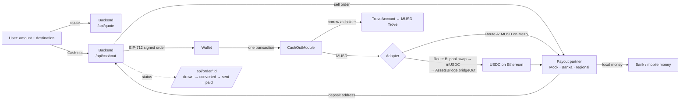

# Assumable

**Assumable loans for Bitcoin: buy and sell live MUSD Troves on Mezo.**

In real estate, an *assumable mortgage* lets a buyer take over the seller's
loan, rate and all, together with the house. Assumable does the same for
MUSD: you sell your whole Trove, meaning its BTC, its debt and its locked
interest rate, in one transaction. You never repay it or close it.

## The problem

MUSD lets you borrow against BTC without selling it. Most people borrow
MUSD in order to **spend** it. That leaves them stuck:

- **Exiting means buying the debt back.** MUSD ties a Trove to the address
  that opened it. The only way out is to repay the whole debt. If you spent
  the MUSD, you first have to buy it all back on the market, with slippage,
  just to reach your own BTC.
- **A low rate can't be passed on.** Each Trove keeps the interest rate it
  was opened at. When governance raises the rate for new Troves, an old 1%
  Trove becomes valuable to someone, but there's no way to sell it.
- **Liquidation is the only other exit.** A borrower who can't repay can
  only wait until they're liquidated, which costs them the liquidation
  penalty on top.

## How it works

```
TrovePositions (ERC-721) ── mints NFT #n and deploys ──▶ TroveAccount #n (minimal clone)
                                                          └─ the borrower of record of a real MUSD Trove

   whoever holds NFT #n controls TroveAccount #n
   transferring the NFT = transferring the Trove, its BTC, its debt and its locked rate

TroveMarket
   list(id, pricing)   fixed MUSD price, or a share of live equity priced by MUSD's oracle
   buy(id, maxPrice, maxDebt, minColl)
                       atomic: MUSD to the seller, NFT to the buyer;
                       reverts if the Trove changed since the buyer looked
   makeOffer / acceptOffer
                       buyers escrow MUSD against any position, listed or not
```

- **`TroveAccount`** opens and runs the Trove through MUSD's own
  `BorrowerOperations`, and only follows orders from the current NFT
  holder. Borrowed MUSD and withdrawn BTC go straight to the holder, so the
  account never holds value that a buyer could inherit or a seller could
  leave behind. Anyone can add collateral or repay, since that only makes
  the Trove safer.
- **Listings are non-custodial.** The seller keeps the NFT, so they can
  still rescue the Trove in a crash. Because the seller could also *weaken*
  the Trove after listing, every purchase carries the buyer's own limits on
  price, debt and collateral, checked in the same transaction as the
  transfer.
- **Equity pricing** asks, for example, 97% of (BTC value − debt) at MUSD's
  oracle price, so the price follows BTC with no manual updates. A seller
  can set an optional floor. A premium above 100% fits Troves locked at a
  rate below today's.
- **Offers** let a buyer escrow MUSD for a specific Trove, with the same
  limits, and the holder accepts whenever they like.

## Cash Out: Bitcoin to local money in one tap

Most people borrow MUSD to **spend** it, and spending usually means local money
in a bank or mobile-money account. Cash Out is that, as one button: pick an
amount in naira (or shillings, cedis, dollars), say where to send it, tap
**Cash out**. The BTC stays as collateral. The screen never says Trove, MUSD,
LTV, bridge, gas or swap; it says what arrives, what it costs, and one
sentence about safety:

> Your Bitcoin is safe unless BTC falls below $31,560 (a 62% drop).

Under that button, one transaction on Mezo:

1. adds BTC as collateral if the loan needs it, and draws MUSD from the
   user's Trove (or opens one, for a first cash-out);
2. checks the loan is at or under **40% LTV**, far from MUSD's ~90.9%
   liquidation line, at MUSD's own oracle price;
3. hands exactly that MUSD to an allowlisted off-ramp adapter, which
   delivers it to the payout partner's deposit address;
4. emits `CashOut(orderId, …)`, which the backend follows to the payout.



### The two routes

- **Route A: MUSD direct** (`DirectMUSDAdapter`). For a partner that takes
  MUSD on Mezo: the MUSD goes straight to its deposit address. No swap, no
  bridge, nothing lost to slippage.
- **Route B: USDC on Ethereum** (`SwapBridgeAdapter`). For a partner that
  only takes USDC: swaps MUSD to mUSDC in Mezo's MUSD/mUSDC stable pool with a
  minimum out, then calls the AssetsBridge precompile's `bridgeOut`, which
  burns the mUSDC on Mezo and releases real USDC on Ethereum to the partner
  (about $3 fee, 30–60 minutes). A contract *can* start this withdrawal:
  `bridgeOut` acts for `msg.sender` with no EOA check (mezod
  `precompile/assetsbridge`, RFC-5). The adapter enforces the bridge's live
  on-chain minimum (20 mUSDC on mainnet, 10 on testnet) and a per-order cap.

MUSD stays central on both routes: every cash-out is a new MUSD loan against
BTC, and every pay-back repays one.

**The pool is thin.** On 2026-10-22 mainnet's MUSD/mUSDC pool returned 98.9
mUSDC for 100 MUSD, 965 for 1,000, and 2,534 for 3,000 (testnet: 841 for
1,000). Quotes price the exact amount in the live pool and show that as a
fee; Route B is capped at 1,000 MUSD per order until the pool deepens.

### Pay back, and the way out

**Pay back** runs the other way: local money in, MUSD out, and
`CashOutModule.repay` pays the loan down. MUSD won't let a partial repayment
take a Trove below its 1,800 MUSD minimum, so the screen offers up to that
and, past it, closing the loan.

If BTC falls and the loan gets close to the line, the screen says so plainly
and offers two exits: pay some back, or **sell the loan** on Assumable's
market, where a buyer takes over the BTC and the debt and pays the user the
equity. That is the rescue sale, and it's why Cash Out sits on Assumable.

### What's real and what's mocked

| | |
|---|---|
| MUSD loans, the LTV cap, the module, both adapters | **Real**, on Mezo |
| Route B's swap (Mezo Pools router and MUSD/mUSDC pool) | **Real** |
| Route B's bridge-out (AssetsBridge precompile) | **Real** on Mezo; stood in for in Foundry and anvil, which can't run precompiles |
| BTC price | **Real** (MUSD's oracle); pinned in tests and the local demo |
| Payout partner `mock` | **MOCK.** Receives the MUSD for real, then *simulates* the bank/mobile-money payout. Fixed sample exchange rates. Labelled "Demo payout" on screen |
| Pay back's on-ramp | **MOCK.** No money is collected; the MUSD comes from the wallet or a demo treasury |
| Payout partner `banxa` | **Stub.** Built against Banxa's v2 sell API as publicly described, off until sandbox credentials are set, field names marked VERIFY. Never reports a success it didn't get |

### Security model

- **Only the loan's owner can cash out against it**, and only with an order
  the backend signed for that owner (EIP-712, single-use, expiring in 10
  minutes). **The user never supplies a destination**: the partner's deposit
  address is inside the signed order. The admin allowlists adapters and can
  additionally pin each adapter's destinations.
- **The module holds the position NFT only inside the call**, to borrow as
  its holder through Assumable's existing interface, and returns it before
  any adapter runs. Assumable's contracts are unchanged.
- **A listed loan can't be cashed out against**, so a buyer's view of it
  holds.
- **Nothing lingers.** The module and adapters keep no tokens, BTC or
  approvals between calls; tests assert it after every path. Reentrancy
  guards throughout; external calls come after state changes.
- **Slippage and minimums.** Route B's swap has a signed minimum out
  (0.5% under the live quote), the module checks the delivered amount
  again, and Route B rejects anything under the bridge minimum.
- **Admin power is limited to trust settings**: adapters, the order signer,
  pausing, and the LTV cap, which can never go above 60%. Pay back is never
  paused. The admin can't move anyone's funds.
- **What the signer key can do if stolen**: sign orders that pay *the
  owner's own* borrowing to an allowlisted adapter and an arbitrary deposit
  address, still under the LTV cap and only when the owner sends the
  transaction. With destinations pinned, not even that.

### Cash Out deployments

| | Testnet (31611) |
|---|---|
| CashOutModule | not yet deployed (see below) |
| DirectMUSDAdapter | not yet deployed |
| SwapBridgeAdapter | not yet deployed |

Deploy with `ORDER_SIGNER=<address> RECORD=1 forge script
script/DeployCashOut.s.sol --rpc-url https://rpc.test.mezo.org --broadcast
--slow --interactives 1`; `RECORD=1` writes the addresses into
`config/mezo-testnet.json`, which the app reads.

## Proven against the real MUSD system

`test/TroveMarket.fork.t.sol` runs on a fork of Mezo testnet against the
live MUSD contracts. It opens a contract-owned Trove, sells it, has the new
owner borrow against it, then closes it.

Mezo's price oracle is a chain precompile that Foundry's EVM can't run, so
the test reads the live price over RPC and pins the feed to it.

## Repository

```
src/TroveAccount.sol         the borrower of record, controlled by an NFT
src/TrovePositions.sol       ERC-721 + clone factory; openPosition() mints and opens in one transaction
src/TroveMarket.sol          listings, equity pricing, offers, buyer and seller protections
src/cashout/                 CashOutModule, IOfframpAdapter, DirectMUSDAdapter (A), SwapBridgeAdapter (B)
config/mezo-*.json           every address the project uses, per network, with sources
test/TroveMarket.t.sol       25 unit tests over a mock of MUSD's borrowing rules
test/TroveMarket.fork.t.sol  end to end against live MUSD on a testnet fork
test/CashOut.t.sol           34 unit tests: both routes, cap, slippage, ownership, listing, allowlist, signatures
test/CashOut.fork.t.sol      both routes against live MUSD, the real pool and router, and real mUSDC
script/Deploy.s.sol          deploys over MUSD on Mezo testnet (31611) or mainnet (31612)
script/DeployCashOut.s.sol   deploys Cash Out over an Assumable deployment
web/                         the market (Next.js, wagmi): browse, open, manage, list, buy, offer
web/src/app/cash/            the Cash Out screen
web/src/app/api/             the off-ramp backend: quote, cashout, order status, payback
web/src/lib/cashout/safety.ts the safety math (21 tests: npm test)
web/src/server/providers/    payout partners: mock, banxa (stub), and the slot for a regional one
scripts/abi.mjs              regenerates web/src/lib/abi.ts and networks.ts from the build and config
scripts/local-demo.sh        a seeded local fork with Cash Out deployed; scripts/btc-price.sh moves BTC
```

## Run it

```sh
forge test
MEZO_FORK=1 MEZO_FORK_BLOCK=$(cast block-number --rpc-url https://rpc.test.mezo.org) \
  forge test --match-contract Fork

forge script script/Deploy.s.sol --rpc-url https://rpc.test.mezo.org --broadcast --slow --interactives 1

cd web
npm install
npm test                     # the safety math
cp .env.example .env.local   # ORDER_SIGNER_PRIVATE_KEY for Cash Out; addresses come from config/
npm run dev                  # Cash Out is at /cash
```

The whole thing locally, with no testnet BTC: `./scripts/local-demo.sh`
forks Mezo testnet into anvil, deploys and seeds Assumable and Cash Out, and
writes `web/.env.development.local`. `./scripts/btc-price.sh 40000` then
moves BTC's price for the demo's crash. See [DEMO.md](DEMO.md).

## Limits and what's next

- **Only Troves opened through Assumable are transferable.** MUSD has no
  way to move an existing Trove to a new owner. Migrating one means repaying
  it and reopening it inside a TroveAccount in the same transaction, which
  needs flash liquidity in MUSD. That is the natural v2.
- Each Trove keeps MUSD's rules: the 1,800 MUSD minimum debt, the 200 MUSD
  gas reserve, and liquidation below 110%. A listed Trove can still be
  liquidated or redeemed against. The market then refuses to sell it, and
  any leftover collateral is claimable by whoever holds the NFT.

## MUSD contracts used

All addresses come from mezo-org/musd `solidity/artifacts/deployments`, and live in
`config/mezo-{testnet,mainnet}.json` with Mezo Pools, the bridge and mUSDC.

| | Testnet (31611) | Mainnet (31612) |
|---|---|---|
| BorrowerOperations | `0xCdF7028ceAB81fA0C6971208e83fa7872994beE5` | `0x44b1bac67dDA612a41a58AAf779143B181dEe031` |
| TroveManager | `0xE47c80e8c23f6B4A1aE41c34837a0599D5D16bb0` | `0x94AfB503dBca74aC3E4929BACEeDfCe19B93c193` |
| PriceFeed | `0x86bCF0841622a5dAC14A313a15f96A95421b9366` | `0xc5aC5A8892230E0A3e1c473881A2de7353fFcA88` |
| InterestRateManager | `0xD4D6c36A592A2c5e86035A6bca1d57747a567f37` | `0x4a453700d157717Fe02fB62E7700ED7845048285` |
| MUSD | `0x118917a40FAF1CD7a13dB0Ef56C86De7973Ac503` | `0xdD468A1DDc392dcdbEf6db6e34E89AA338F9F186` |
